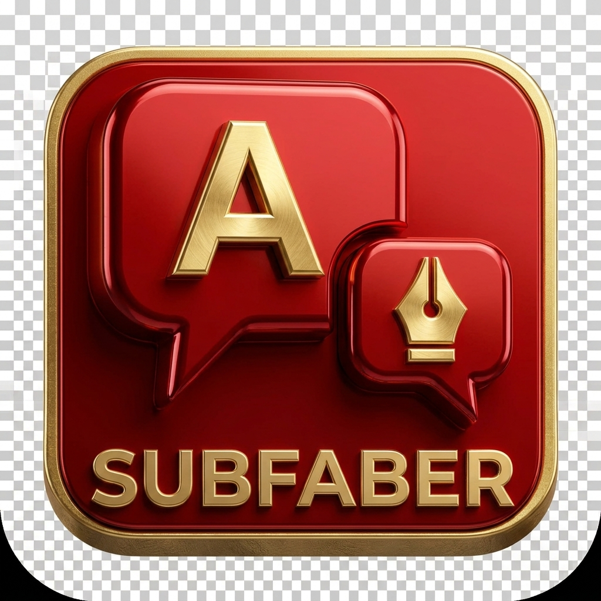

<p align="center">
  
</p>

<h1 align="center">SubFaber</h1>

<p align="center">
  <b>AI-Powered Subtitle Translation for Stremio</b><br/>
  Watch any content in your language. Fetch subtitles from multiple sources, translate instantly with AI — without ever leaving your player.
</p>

<p align="center">
  <a href="https://www.gnu.org/licenses/agpl-3.0"></a>
  
  
  
  
</p>

<p align="center">
  <a href="#-features">Features</a> •
  <a href="#-quick-start">Quick Start</a> •
  <a href="#-how-it-works">How It Works</a> •
  <a href="#-troubleshooting">Troubleshooting</a>
</p>

---

## ✨ Features

| Category | Highlights |
|----------|------------|
| **Languages** | 198 languages in the subtitle menu (383 translation codes incl. regional variants) |
| **Subtitle Sources** | OpenSubtitles, SubDL, SubSource |
| **AI Translation** | 11 providers: Gemini, OpenAI, Claude, DeepSeek, DeepL, Google Translate, Mistral, OpenRouter, xAI Grok, Cloudflare Workers AI, Custom/Proxy |
| **Smart Caching** | Shared translation database — translate once, benefit everyone |
| **Timestamp Workflow** | XML Tags — the single enterprise workflow (deterministic reconstruction) |
| **No-Translation Mode** | Just fetch subtitles without translation |

---

### 🌍 Subtitle Sources

| Provider | Auth Required | Notes |
|----------|---------------|-------|
| OpenSubtitles | Optional (recommended) | V3 or authenticated mode |
| SubDL | API key | [subdl.com/panel/api](https://subdl.com/panel/api) |
| SubSource | API key | [subsource.net](https://subsource.net/) |

### 🤖 AI Translation Providers

| Provider | Notes |
|----------|-------|
| **Google Gemini** | Default, free tier available, key rotation supported |
| OpenAI | GPT models |
| Anthropic | Claude models |
| DeepSeek | |
| DeepL | Traditional translation API |
| Google Translate | Unofficial, no key needed |
| Mistral | |
| OpenRouter | Access multiple models |
| xAI (Grok) | |
| Cloudflare Workers AI | |
| Custom / Proxy | Ollama, LM Studio, LocalAI, any OpenAI-compatible API, or a Gemini-native proxy gateway |

> A secondary fallback provider can be enabled alongside the main provider (multi-provider mode).

---

## 🚀 Quick Start

### Prerequisites

- **Node.js** 22.9+ with npm 11.17 or newer — [nodejs.org](https://nodejs.org) (the official Docker image builds on `node:24-alpine`, which satisfies this requirement)
- An AI translation provider key of your choice — Gemini is only ONE of the 11 supported AI providers (OpenAI, Anthropic, DeepSeek, DeepL, Google Translate, Mistral, OpenRouter, xAI Grok, Cloudflare Workers AI, or any custom endpoint); for a free tier, [get a Gemini key](https://aistudio.google.com/app/api-keys)
- An OpenSubtitles API key — OpenSubtitles is the primary source-subtitle provider and is recommended for maximum coverage (SubDL and SubSource keys are optional alternatives)

### Installation

```bash
# Clone and install
git clone https://github.com/mfzf99/StremioSubFaber.git
cd StremioSubFaber
npm install

# Create and configure .env
cp .env.example .env
nano .env

# Start the server
npm start
```

### 🐳 Docker

📦 **[See complete Docker deployment guide →](docs/DOCKER.md)**

### Open Configuration

Visit: **http://localhost:7001**

---

## 🎯 How It Works

```
1. Install SubFaber in Stremio
2. Play content → Subtitles list shows "Make [Language]" buttons
3. Click → Select source subtitle to translate
4. Wait ~1-3 minutes → AI translates in batches
5. Reselect the subtitle → Now translated!
6. Next time? Instant — cached in database
```

### Configuration Steps

1. **Add Subtitle Sources API keys**
2. **Add Gemini API Key** (required for translation)
3. **Select source languages** (translate from)
4. **Select target languages** (translate to)
5. **Click "Install in Stremio"** or copy the URL

### Pro Tips

| Tip | Description |
|-----|-------------|
| **Single source language** | Keeps subtitle order consistent |
| **Test sync first** | Try original subtitle before translating |
| **Triple-click** | Forces re-translation if result looks wrong |
| **Use Flash-Lite** | Fastest model, check rate limits |

---

## ⚙️ Configuration Guide

### Sections Overview

| Section | Purpose |
|---------|---------|
| **API Keys** | Subtitle providers and AI translation keys |
| **Languages** | Source (translate from) and target (translate to) |
| **Settings** | Translation behavior, workflows, and caching |

### Key Settings

| Setting | Recommendation |
|---------|----------------|
| Translation Workflow | "XML Tags" for best sync |
| Database Mode | "Use SubFaber Database" for shared caching |
| Provider Timeout | 12s default, increase to 30s for slow providers |
| Mobile Mode | Enable for Android/iOS |

### Advanced Mode

Enable "Advanced Mode" in Other Settings to unlock:
- Batch Context (surrounding context for coherence)
- Mismatch Retries (retry on wrong entry count)
- Model-aware Gemini Parameters — the panel reshapes itself to the selected model:
  - **Thinking Level** (Minimal/Low/Medium/High) for Gemini 3.x models
  - **Thinking Budget** (0 = off, -1 = dynamic, Pro min 128) for Gemini 2.5 models
  - **Sampling controls** — temperature, top-P, top-K, frequency & presence penalties — for Gemini 1.5/2.0/2.5 (automatically managed and disabled for newer Gemini 3.x models)

> **Model Discovery:** Both the base and override model dropdowns are populated live from your API key via Google's model list, so newly released models appear automatically without waiting for an app update.

---

## 🐛 Troubleshooting

> **📖 Full Guide:** [TROUBLESHOOTING.md](docs/TROUBLESHOOTING.md)

### ⏱️ Subtitles Out of Sync?

SubFaber uses a single deterministic **XML Tags** workflow — original timecodes are preserved by reconstructing entries from XML id tags, so sync drift from the workflow itself is not expected. If subtitles drift:

1. **Try another source subtitle** — the source file itself may be mistimed
2. **Force re-translation** — Triple-click the subtitle (within 6 seconds)
3. **Bypass cache** — Enable "Bypass Cache" in Translation Settings

### 🔄 Bad / Broken Translation?

1. **Force re-translation** — Triple-click the subtitle (within 6 seconds)
2. **Try a different model** — Switch between Flash-Lite, Flash, or others
3. **Bypass cache** — Enable "Bypass Cache" in Translation Settings

### ❌ Translation Fails / Rate Limits?

1. **Validate API key** — Test at [Google AI Studio](https://aistudio.google.com)
2. **Switch model** — Gemma 27b has higher rate limits than Flash
3. **Enable key rotation** — Add multiple Gemini keys
4. **Use secondary provider** — Enable fallback provider

### 📱 Android / Mobile Issues?

1. **Enable Mobile Mode** — Check "Mobile Mode" in Other Settings
2. **Wait 1-3 minutes** — Mobile delivers complete subtitle when ready
3. **Use Flash-Lite** — Fastest model for mobile

### 💾 Configuration Not Saving?

1. **Verify Token** — Ensure installed token matches config page
2. **Hard refresh** — `Ctrl+F5` (Windows/Linux) or `Cmd+Shift+R` (Mac)
3. **Check console** — `F12` → Console for errors
4. **Try incognito** — Rules out extension conflicts

### ⚡ Reset Everything

Click the **Reset** button at the bottom of the config page.

---

## 🙏 Acknowledgments

**Built With**
- [Stremio Addon SDK](https://github.com/Stremio/stremio-addon-sdk) — Addon framework
- [OpenSubtitles](https://www.opensubtitles.com/) — Primary subtitle database
- [SubDL](https://subdl.com/) — Alternative subtitle source
- [SubSource](https://subsource.net/) — Alternative subtitle source
- [Google Gemini](https://ai.google.dev/) — AI translation

**Special Thanks**
- Stremio team for excellent addon SDK
- Google for free Gemini API access
- All subtitle communities

---

## 📧 Support

| Channel | Link |
|---------|------|
| **Issues & Bugs** | [Open an issue](https://github.com/mfzf99/StremioSubFaber/issues) |
| **Documentation** | Open `/configure` for the live interactive config/help page |
| **Community** | [Stremio Discord](https://discord.gg/stremio) • [r/StremioAddons](https://reddit.com/r/StremioAddons) |

---

<p align="center">
  <b>SubFaber</b> — Watch anything. Understand everything.<br/>
  <sub>Made with ❤️ for the Stremio community</sub>
</p>

<p align="center">
  <a href="https://github.com/mfzf99/StremioSubFaber">⭐ Star this repo</a> •
  <a href="https://github.com/mfzf99/StremioSubFaber/issues">🐛 Report Bug</a> •
  <a href="https://github.com/mfzf99/StremioSubFaber/issues">✨ Request Feature</a>
</p>
